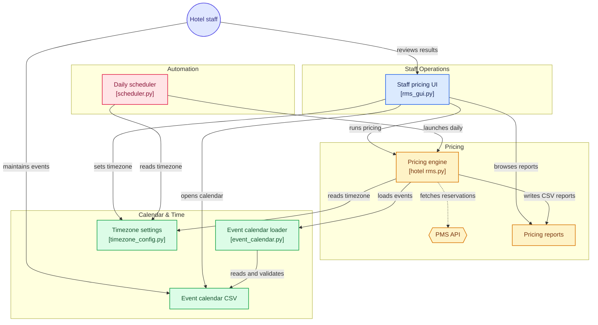

<p align="center"><a href="README.md">English</a> | <a href="README.zh-CN.md">简体中文</a></p>

# Hotel RMS (Pricing Suggestion)

A self-contained **decision-support demo** for a single hotel property. It
builds a 90-day rate recommendation per room type from booking pace,
occupancy, lead time, competitor benchmarks and a staff-maintained
public-holiday / special-event calendar, then writes two CSV reports. A
separate Tkinter UI (`rms_gui.py`) can be launched to review those reports.

> **Read this first.** With no PMS credentials configured, the engine runs in
> `DEMO` mode: reservations, competitor rates and baseline ADR are synthetic.
> The reports carry a `Data_Mode` column and the UI shows a permanent warning.
> Rates produced in this mode are for demonstration and review only - do not
> publish them to a booking channel.

`User_Guide.txt` is the short operator quick-reference. Where the two differ,
this README is authoritative. A Chinese edition is available at
[README.zh-CN.md](README.zh-CN.md); it describes the same behaviour, and the
English text governs if wording differs. `Public holidays.csv` carries a
condensed copy of the calendar rules in its comment header.

## Contents

[Files](#files) · [Architecture](#architecture) · [Requirements](#requirements) ·
[Quick start](#quick-start) · [Public holidays / special events](#public-holidays--special-events) ·
[Pricing model](#pricing-model) · [Reproducibility](#reproducibility) ·
[Data sources (honest status)](#data-sources-honest-status) ·
[PMS data interface](#pms-data-interface) ·
[Scheduler and timezone](#scheduler-and-timezone) ·
[Generated outputs](#generated-outputs) · [Troubleshooting](#troubleshooting) ·
[Privacy](#privacy)

## Files

| File | Purpose |
| --- | --- |
| `hotel rms.py` | Pricing engine: PMS adapter, 90-day rate model, CSV exports |
| `event_calendar.py` | Library module that loads and validates `Public holidays.csv`; imported by the engine. Not run directly |
| `Public holidays.csv` | **Staff-maintained** holidays and special events (the only event input) |
| `rms_gui.py` | Tkinter staff UI: run pricing, browse results, explain rates, open the calendar |
| `scheduler.py` | Long-running scheduler for the daily 06:00 run (`--run-now` runs one cycle first, then stays resident) |
| `timezone_config.py` | Shared timezone settings and IANA availability checks; library module, not run directly |
| `Run_Pricing_Now.bat` | Windows: run one pricing cycle |
| `Start_Pricing_UI.bat` | Windows: open the staff UI |
| `User_Guide.txt` | Short operator guide |

The runnable entry points are `hotel rms.py` (one cycle), `rms_gui.py` (UI) and
`scheduler.py` (resident scheduler). `event_calendar.py` and
`timezone_config.py` are imported by those scripts and have no command-line
interface. The two `.bat` files are Windows shortcuts for the first and
second entry points.

`timezone_settings.json` is created locally by the staff UI when a timezone
is chosen; it is git-ignored, so a fresh clone starts on local system time.
Generated reports, runtime logs, `__pycache__` and local credentials are also
git-ignored (see `.gitignore`).

## Architecture

The diagram below shows how the scripts, staff-maintained inputs and generated
reports fit together at runtime. Solid arrows are direct interactions (launch,
read, write, maintain); the dotted arrow is the optional PMS fetch, which is
short-circuited to synthetic data in `DEMO` mode.



`hotel rms.py` is the hub: it loads the event calendar through
`event_calendar.py`, reads the shared timezone settings, fetches reservations
only when the PMS client is enabled, and writes both CSV reports. A cycle is
started either from the staff UI or by `scheduler.py`; both also read the same
timezone settings. Which inputs are real and which are synthetic is spelled out
in [Data sources (honest status)](#data-sources-honest-status).

## Requirements

Python 3.9+ and:

```bat
pip install pandas numpy requests schedule
```

`schedule` is used only by `scheduler.py`. `tkinter` ships with standard
CPython on Windows and macOS; on some Linux distributions it is a separate
package (for example `python3-tk`). The two `.bat` files expect Python on
`PATH` and fall back to `py`; on other platforms run the scripts directly.

Named IANA timezones additionally need the system IANA timezone database; on
Windows install the optional `tzdata` package (`pip install tzdata`). The
default `Follow local system time` needs nothing extra and works out of the
box. No `pytz` dependency is required - see
[Scheduler and timezone](#scheduler-and-timezone).

## Quick start

Run all commands from the repository directory; the `.bat` launchers do this
for you. Reports are written to the current working directory.

```bat
python "hotel rms.py"          # one pricing cycle -> two CSV reports
python rms_gui.py              # staff UI (click "Run Pricing Now")
python scheduler.py --run-now  # one cycle now, then stay resident for daily 06:00 runs
```

`scheduler.py --run-now` does **not** return after the first cycle: it keeps
running to serve the daily job. Leave its window open and press `Ctrl+C` to
stop it. With no scheduler process running there is no automatic 06:00 run.

With no PMS credentials configured, the engine short-circuits to clearly
labelled synthetic data and makes no network requests - the default `DEMO`
mode works fully offline. Setting `PMS_API_KEY` and `PMS_BASE_URL` enables the
optional live HTTP client (see [PMS data interface](#pms-data-interface)), so
those configurations do require network access.

## Public holidays / special events

`Public holidays.csv` is the **single source of event factors**. Staff edit it
directly in Excel or Notepad; there are no hard-coded events in the engine.
Click **Open Event Calendar** in the UI to open it, save the file as UTF-8
CSV, then click **Run Pricing Now** again. No restart is needed.

### Columns

| Column | Format | Meaning |
| --- | --- | --- |
| `Date` | `YYYY/MM/DD`, e.g. `2026/12/25` | A full date with a four-digit year. With `Recurring=Y` only its month/day is used, so it repeats every year and the written year is a placeholder. Otherwise the exact date is priced once |
| `Event_Name` | free text, may be empty | Shown in reports. If empty, the reason reads `Public Holiday Demand Window Triggered` |
| `Event_Factor` | number > 0 | Demand multiplier: `1.00` neutral, `1.25` = +25%, `0.90` = -10%. Usual range 0.50-3.00; values outside it are still loaded but produce a `[WARN]` line |
| `Category` | `Public Holiday` / `Special Event` / `School Holiday` / `Custom` | Used in the pricing reason. Unknown values are mapped to `Special Event` with a warning |
| `Recurring` | `Y` or `N` (blank = `N`) | `Y` repeats the same month/day every year |

`Holiday_Factor` and `Special_Event_Factor` are accepted as aliases for
`Event_Factor`, so older files using those column names still load. Every row
must still carry a complete date: `YYYY/MM/DD` is the current format and the
legacy `YYYY-MM-DD` spelling is accepted, but a bare `MM-DD` is **not**.
An older calendar that used `MM-DD` rows needs those dates rewritten before
it can be used. Lines starting with `#` and blank lines are ignored, which is
why the shipped file can carry its own instructions.

### Rules

- Dates are **absolute**. A stay date always gets the same event factor, no
  matter which day the engine runs; no `today + N` offsets are used.
- With `Recurring=Y` only the month and day are used, so fixed-date holidays
  carry over to future years.
- A one-off row (`Recurring=N`) overrides a recurring row on that same date,
  regardless of which one appears first in the file. Among rows of the **same
  kind**, the last row wins. Use a one-off row to override a holiday for one
  specific year.
- Only dates inside the current 90-day window are priced. The window starts
  on the current date in the selected property timezone, so switching across
  the date line can shift it by one day and change which calendar rows fall
  inside it. This is expected behaviour, not a calendar error.
- A missing file, a missing `Date` / `Event_Factor` column, a bad date, a
  non-numeric or non-positive factor stops the run with an error and a line
  number. The engine does **not** silently fall back to demo events.
- When a year covered by the window has no event rows at all, the run prints
  a warning reminding staff to maintain that year's calendar. Recurring rows
  expanded into that year count, so a calendar of annual holidays stays quiet.
- Fatal vs non-fatal input problems: only malformed calendar rows abort a
  run. A bad PMS timestamp or an invalid stored timezone emits a `[WARN]`
  line and falls back to a default, so neither can block a pricing run.

### About the shipped calendar

`Public holidays.csv` ships with five fixed-date example rows, all
`Recurring=Y`: New Year's Day, Christmas Eve, Christmas Day, Christmas
Weekend and New Year's Eve. Their factors range from 1.20 to 1.50 and the
written year is only a placeholder, so they also apply in later years.

These rows are examples, not a complete holiday list. Replace or extend them
with the dates that matter to your property. Use `Recurring=N` for movable
dates that change every year (for example lunar-new-year dates, school
holiday periods and observed-in-lieu holidays), and refresh those rows each
year from your local official holiday calendar. The demo does not assume any
particular country or property; the shipped rows are generic fixed dates.

**Excel note.** The CSV itself is plain ASCII English text with no non-ASCII
characters. Excel may reformat a date cell using your system locale - on a
Chinese locale, `2026/12/25` may be displayed as `2026年12月25日` - even
though the file contains no such characters. To keep the exact `YYYY/MM/DD`
text, format the `Date` column as Text before editing, or use Notepad /
VS Code. The on-screen format does not change what the engine reads.

## Pricing model

```text
Base_Room_ADR     = BASELINE_ADR x RoomType_Factor
                    (Standard 135 x 1.00 = 135; Premium 160 x 1.25 = 200)
Recommended_ADR   = Base_Room_ADR x Weekend x Event_Factor x Occupancy
                         x Lead_Time x Booking_Pace x Competitor
Final_ADR         = round(clip(Recommended_ADR, MIN_ADR, MAX_ADR), 0)
```

The factor tables (weekend, occupancy, pace, lead time, competitor), the
same-day time-decay layer and the guest-density surcharge are defined in
`hotel rms.py`. "Baseline" in this document always means the shipped
`BASELINE_ADR` configuration, not a previous release of the tool.

Rate guards give event days extra headroom so a strong event factor is not
clipped by the generic ceiling:

```text
MIN_ADR = Base_Room_ADR x 0.70
MAX_ADR = Base_Room_ADR x max(2.00, Event_Factor x 1.60)
```

With the largest shipped event factor of `1.50`, the ceiling becomes
`max(2.00, 1.50 x 1.60) = 2.40 x Base_Room_ADR`, so those holiday rows have
room to affect `Final_ADR` instead of being clipped at `2.00 x Base_Room_ADR`.
Every clipped row is flagged with `Rate_Cap_Applied` in the technical view and
`| Rate ceiling applied` / `| Rate floor applied` in the manager view, so a
guard hit is never hidden.

## Reproducibility

Event factors are absolute and competitor ADR is a deterministic hash of the
stay date, so those inputs are comparable across runs and years.

To replay a complete window - for back-testing, training or year-over-year
comparison - set `RMS_AS_OF_DATE` in `YYYY/MM/DD` form before running. The
synthetic reservation feed and the report date suffix are then anchored to
that date too:

```bat
set RMS_AS_OF_DATE=2026/09/01
python "hotel rms.py"
```

PowerShell: `$env:RMS_AS_OF_DATE = "2026/09/01"`, then the same `python` line.
On bash / macOS: `export RMS_AS_OF_DATE=2026/09/01`.

For a repeatable *time of day* (used to check the same-day discount tiers),
set `RMS_AS_OF_DATETIME` to a wall-clock timestamp in the selected timezone.
This variable keeps the ISO `YYYY-MM-DD HH:MM:SS` form because it is parsed
as a PMS timestamp, not as a calendar date:

```bat
set RMS_AS_OF_DATETIME=2026-09-01 22:30:00
python "hotel rms.py"
```

PowerShell: `$env:RMS_AS_OF_DATETIME = "2026-09-01 22:30:00"`.
On bash / macOS: `export RMS_AS_OF_DATETIME="2026-09-01 22:30:00"`.
Quote the value on those shells because it contains a space.

Leave both variables unset for normal daily operation. In `DEMO` mode the
synthetic reservation feed is anchored to the run date, so OTB and pace
figures differ between runs on *different* days; `RMS_AS_OF_DATE` removes
even that variation. Reproducible *operational* inputs would additionally
require a live PMS integration, which is not bundled with this demo; see the
next section for the optional HTTP client.

## Data sources (honest status)

| Input | `DEMO` | `LIVE_PMS_SYNTHETIC_MARKET` |
| --- | --- | --- |
| Reservations / occupancy | Synthetic, anchored to the run date | Live PMS v1.3 |
| Competitor ADR | Deterministic synthetic hash per stay date | Deterministic synthetic hash per stay date |
| Baseline ADR | Constant `BASELINE_ADR` | Constant `BASELINE_ADR` |
| Holidays / events | `Public holidays.csv` (staff-maintained) | `Public holidays.csv` (staff-maintained) |

`deterministic_competitor_adr()` and `BASELINE_ADR` in `hotel rms.py` are the
two replacement points for a real rate-shopper feed and a real historical ADR
feed. Until those are replaced, even a live PMS connection still produces a
partly synthetic recommendation; that is why the mode is named
`LIVE_PMS_SYNTHETIC_MARKET` rather than `LIVE`.

## PMS data interface

The request layout follows Cloudbeds API v1.3 conventions as a **format
reference only**. This repository is not affiliated with any vendor, ships no
real endpoint or credential, and bundles no working integration.

To point the optional HTTP client at your own PMS, set both `PMS_BASE_URL`
(the base URL of an API implementing the two endpoints below) and
`PMS_API_KEY` (the value sent as `x-api-key`), then start any of the pricing
entry points. The engine stays in `DEMO` mode if either variable is unset, if
the key still starts with `YOUR_`, or if `PMS_BASE_URL` still contains
`example-pms.com`.

- Header: `x-api-key: <your key>` - the value of `PMS_API_KEY`
- `GET {BASE_URL}/getDashboard` -> `data` with `capacity`, `roomsBlocked`,
  `inHouse`, `guestsInHouse`, `percentageOccupied`, `property_now`
- `GET {BASE_URL}/getReservations` -> `data[]` with `reservationID`,
  `dateCreated`, `status`, `startDate`, `endDate`, `balance`
  (statuses used: `confirmed`, `checked_in`, `checked_out`)

`{BASE_URL}` above is the value of `PMS_BASE_URL`. `property_now` is
interpreted in the selected property timezone: a value without a UTC offset
is treated as wall-clock time in that timezone, while a value with an offset
is converted to it. Missing or unparseable values fall back to the current
property time with a `[WARN]` line, so a bad timestamp never stops a run.

Never commit real credentials. Without them the engine short-circuits to
synthetic data instead of waiting on a network timeout, although the console
still prints a "Connecting to PMS API v1.3" line before falling back.

## Scheduler and timezone

Pick the property timezone from the second-row **Timezone** dropdown in the
staff UI. The choice takes effect as soon as it is selected - there is no
Apply button - and pricing is re-run automatically so the table shows rates
for the new timezone.

The default is `Follow local system time`, which needs no timezone database at
all. Named IANA zones (for example `Europe/London`) need the system IANA
database; on Windows install `tzdata` (see [Requirements](#requirements)). If
the database is missing the UI explains what to install and keeps the
local-time setting; an invalid stored value only emits a `[WARN]` line and
never blocks a pricing run. UTC offsets shown in the dropdown are computed at
runtime, so daylight-saving changes are handled automatically.

The choice is stored in `timezone_settings.json` in the script folder:

```json
{"timezone": "Europe/London", "schema_version": 1}
```

`"timezone": null` means local system time. This file is written only by the
UI and is git-ignored.

Timezone handling uses the standard library only. The scheduler converts
06:00 in the selected zone into the equivalent machine-local wall-clock time
and registers a plain daily job; it does not pass a timezone to `schedule`
and does not require `pytz`. It recomputes that time every minute, so
daylight-saving transitions are picked up automatically without a restart.

The same setting drives **all** of the following:

- The unattended 06:00 run. It requires `scheduler.py` to be running as a
  long-lived process (`python scheduler.py --run-now`); see
  [Quick start](#quick-start). A running scheduler notices a configuration
  change within about a minute and rebuilds its job, so no restart is needed.
- The pricing engine's "today": the 90-day window, day-of-week factors,
  days-to-check-in, the report date suffix and the timestamped fallback
  filenames.
- The PMS `property_now` hour, which drives the same-day discount tiers
  (18:00 / 20:00 / 22:00). In `DEMO` mode this hour is the current wall-clock
  time in the selected timezone, so the sample rates react to a switch too.

Switching across the date line can therefore move the window by one day and
change which holiday rows are inside it - see the calendar **Rules** section
above.

## Generated outputs

Each run creates two reports in the **current working directory** (the
launchers set this to the script folder):

- `hotel_name_Live_Dashboard_YYYY-MM-DD.csv` - technical view, 20 columns:
  `Stay_Date`, `Room_Type`, `Day_of_Week`, `Event_Name`, `Event_Category`,
  `Event_Factor`, `Event_Source`, `Days_to_Checkin`, `Current_Occupancy`,
  `Pace_Ratio`, `Base_Room_ADR`, `Competitor_ADR`, `Recommended_ADR`,
  `MIN_ADR`, `MAX_ADR`, `Rate_Cap_Applied`, `Final_ADR`, `Expected_RevPAR`,
  `Confidence_Score`, `Data_Mode`. `Recommended_ADR` is the value before
  guarding.
- `hotel_name_RMS_Manager_View_YYYY-MM-DD.csv` - manager view, 10 columns:
  `Stay_Date`, `Room_Type`, `Current_Occupancy`, `Final_ADR`,
  `ADR_Change_vs_Base`, `Demand_Status`, `Action`, `Confidence_Score`,
  `Reason`, `Data_Mode`.

Both are git-ignored. If a report is open in Excel and cannot be overwritten,
the engine instead saves `..._YYYY-MM-DD_HHMMSS.csv` and logs a `[WARN]`
line naming the fallback file.

The `Stay_Date` column inside both reports uses `YYYY/MM/DD`, matching the
event calendar and the `RMS_AS_OF_DATE` variable. File names deliberately keep
the ISO `YYYY-MM-DD` suffix: a slash (`/`) cannot appear in a Windows file
name (the native Windows path separator is `\`). The staff UI locates reports
with a regex that matches that suffix.

### Report retention

After the two reports are written, the engine keeps only the newest 3 distinct
report dates in the folder and MOVES older ones - including their `_HHMMSS`
fallback copies - into an `archive/` subfolder. This is a soft delete: nothing
is deleted, so drag a file back out of `archive/` to restore it. The decision
uses the ISO date parsed from the file name in the selected property timezone,
not the file modification time or calendar days; a report date in the future
or an unparseable name is left alone with a `[WARN]`.

Tune the window with `RMS_REPORT_KEEP` (default `3`). Preview the exact file
list without moving anything by setting `RMS_REPORT_RETENTION_DRY_RUN=1`.
Back-test runs that set `RMS_AS_OF_DATE` or `RMS_AS_OF_DATETIME` skip
retention entirely, so replay reports are never archived. Retention failures
only produce a `[WARN]` and never fail a pricing cycle. The staff UI scans
only the script folder, so archived reports are not shown as the latest
result.

## Troubleshooting

| Symptom | What to check |
| --- | --- |
| `python` is not recognised | Install Python 3.9+ and put it on `PATH`, or use the `.bat` launchers (they fall back to `py`). |
| `ModuleNotFoundError` | Run `pip install pandas numpy requests schedule`; add `tzdata` on Windows if you use named timezones. The UI also reports missing packages in its log box. |
| `[ERROR] Event calendar not found` | Confirm `Public holidays.csv` exists beside the scripts. If it is missing, restore it from version control or recreate it with the header shown in **Columns**; the engine will not produce rates from an incomplete calendar. |
| An error names a calendar line number | Fix that row in `Public holidays.csv` and run again. Bare `MM-DD` dates and non-positive or non-numeric factors are rejected. |
| Reports are not where you expected | They are written to the current working directory. `cd` to the repository first, or use the `.bat` launchers. |
| No automatic 06:00 run | A scheduler process must be running (`python scheduler.py --run-now`). It stays resident; close its window or press `Ctrl+C` to stop it. |
| `Timezone data not available` in the UI | Run `pip install tzdata`, then reopen the UI; or keep `Follow local system time`. |
| Excel shows dates differently | See the **Excel note** above and format the `Date` column as Text. |
| Dates shifted by one day after a timezone switch | Expected: the 90-day window starts on the current date in the selected property timezone. |

## Privacy

Property and brand names, vendor names in code, machine-specific paths, real
credentials, historic business reports and personal metadata have been
replaced with generic placeholders such as `hotel_name`. No real customer,
business or personal data is included; all figures are demo values. Third-party
API names appear in this document only as format references; no vendor
endpoint or integration is bundled.
