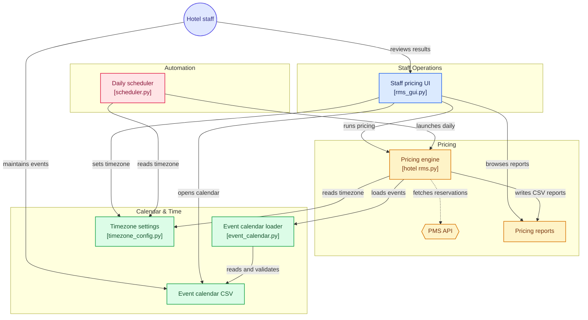

<p align="center"><a href="README.md">English</a> | <a href="README.zh-CN.md">简体中文</a></p>

# Hotel RMS（定价建议）

单酒店定价决策演示。按房型生成未来 90 天的建议房价，输入包括预订进度、入住率、提前天数、竞品价格，以及员工维护的节假日 / 活动日历。每次运行输出两份 CSV；另有一个独立的 Tkinter 界面用于查看结果和解释定价。

> 未配置 PMS 凭据时运行在 `DEMO` 模式：预订、竞品价、基准 ADR 均为合成数据；报告带 `Data_Mode` 列，界面常驻警告。此模式的房价仅供演示与评审，不得发布到售卖渠道。

`User_Guide.txt` 是英文操作员速查。英文 `README.md` 为原文，本文为对应的中文版；措辞有差异时以英文版为准。

## 文件

| 文件 | 用途 |
| --- | --- |
| `hotel rms.py` | 定价引擎：PMS 适配、90 天模型、CSV 导出 |
| `event_calendar.py` | 加载并校验事件日历的库模块，被引擎导入，不直接运行 |
| `Public holidays.csv` | **员工维护**的节假日与活动，唯一的事件因子来源 |
| `rms_gui.py` | Tkinter 界面：运行定价、查看结果、解释房价、打开日历 |
| `scheduler.py` | 常驻调度进程，每日 06:00 运行（`--run-now` 先跑一次再常驻） |
| `timezone_config.py` | 共享时区设置与 IANA 可用性检查，库模块 |
| `Run_Pricing_Now.bat` | Windows：运行一次定价 |
| `Start_Pricing_UI.bat` | Windows：打开界面 |
| `User_Guide.txt` | 操作员速查（英文） |

可运行入口只有 `hotel rms.py`、`rms_gui.py`、`scheduler.py`。`timezone_settings.json` 由界面选择时区时生成，已被 git 忽略；报告、日志、`__pycache__`、本地凭据同样被忽略。

## 系统架构

下图展示各脚本、员工维护的输入与生成的报告在运行时的依赖关系。实线为直接交互（启动、读写、维护），虚线为可选的 PMS 取数（`DEMO` 模式下短路为合成数据）。四个分组依次为员工操作、定价、日历与时区、自动化调度；节点文字保留生成时的英文，便于日后从仓库重新生成。



`hotel rms.py` 是中心：经 `event_calendar.py` 载入事件日历、读取共享时区设置、启用 PMS 客户端时拉取预订、写出两份 CSV。运行由界面或 `scheduler.py` 触发，两者也都读取同一份时区设置。真实 / 合成数据的区分见「数据来源」。

## 环境要求

Python 3.9+：

```bat
pip install pandas numpy requests schedule
```

`schedule` 只供 `scheduler.py` 使用。`tkinter` 随 Windows / macOS 版 CPython 提供，部分 Linux 发行版需单独安装（如 `python3-tk`）。两个 `.bat` 要求 `python` 在 `PATH` 上，找不到时回退到 `py`。命名 IANA 时区需要系统时区数据库，Windows 上另装 `tzdata`；默认的 `Follow local system time` 无需额外依赖，也不需要 `pytz`。

## 快速开始

先 `cd` 到仓库目录，`.bat` 启动器会自动切换。报告写入**当前工作目录**。

```bat
python "hotel rms.py"          # 运行一次，生成两份 CSV
python rms_gui.py              # 打开界面，点 "Run Pricing Now"
python scheduler.py --run-now  # 先跑一次，然后常驻等待每日 06:00
```

`scheduler.py --run-now` 跑完不会退出：需保持窗口，按 `Ctrl+C` 结束。没有常驻进程就没有每日 06:00 的自动运行。

默认无 PMS 凭据时引擎走合成数据、不发网络请求，可完全离线运行。设置 `PMS_API_KEY` / `PMS_BASE_URL` 后会启用可选的 HTTP 客户端，此时需要网络。

## 节假日 / 活动日历

`Public holidays.csv` 是事件因子的唯一来源，引擎内没有硬编码事件。界面点 **Open Event Calendar** 打开，另存为 UTF-8 CSV，再点 **Run Pricing Now**；无需重启。

### 列

| 列 | 格式 | 含义 |
| --- | --- | --- |
| `Date` | `YYYY/MM/DD`，如 `2026/12/25` | 必须带四位年份。`Recurring=Y` 时只取月日，年份为占位符；否则只定价该日期一次 |
| `Event_Name` | 文本，可空 | 显示在报告中；为空时原因显示 `Public Holiday Demand Window Triggered` |
| `Event_Factor` | > 0 的数值 | 需求乘数：`1.00` 不变，`1.25` 为 +25%，`0.90` 为 -10%。常用区间 0.50–3.00，越界仍会载入但输出 `[WARN]` |
| `Category` | `Public Holiday` / `Special Event` / `School Holiday` / `Custom` | 用于定价原因；未知值映射为 `Special Event` 并告警 |
| `Recurring` | `Y` 或 `N`（空 = `N`） | `Y` 每年重复同一月日 |

`Holiday_Factor`、`Special_Event_Factor` 可作为 `Event_Factor` 的别名。旧版 `YYYY-MM-DD` 仍接受，裸 `MM-DD` **不接受**：旧日历若用了 `MM-DD`，需先改写日期。`#` 开头行与空行忽略。

### 规则

- 日期是绝对值：同一入住日期的事件因子不随运行日变化，不使用 `today + N` 偏移。
- `Recurring=Y` 只取月日，固定日期节假日自动延续到后续年份。
- 同一日期上，一次性行（`Recurring=N`）覆盖年度行，**不论先后顺序**；同类型行之间，文件中最后一行胜。用一次性行可覆盖某一年的节假日。
- 只定价当前 90 天窗口内的日期。窗口从所选物业时区的当日开始，跨日期线切换时区可能让窗口平移一天，属预期行为。
- 文件缺失、缺 `Date` / `Event_Factor` 列、日期非法、因子非数值或 ≤ 0：中止运行并给出行号，不静默回退到演示事件。
- 窗口覆盖的某年完全没有事件行时输出警告；展开到该年的年度行也算在内，因此只有年度节假日的日历不会每年告警。
- 只有日历错误会中止运行；PMS 时间戳或时区设置异常只输出 `[WARN]` 并回退默认值。

### 随附示例

文件带 5 行固定日期示例，全部 `Recurring=Y`：元旦、平安夜、圣诞节、圣诞周末、除夕，因子 1.20–1.50。它们只是示例，不是完整节假日表。按物业实际情况替换或增补；每年变动的日期用 `Recurring=N`，并每年依据当地官方日历刷新。演示不假定任何国家或物业。

**Excel 提示**：CSV 本身是纯 ASCII 英文文本。Excel 可能按系统区域设置重排日期单元格，例如中文环境下把 `2026/12/25` 显示为 `2026年12月25日`，但文件里并没有这些字符。编辑前把 `Date` 列设为文本，或改用 Notepad / VS Code；屏幕显示不影响引擎读取。

## 定价模型

```text
Base_Room_ADR     = BASELINE_ADR x RoomType_Factor
                    (Standard 135 x 1.00 = 135; Premium 160 x 1.25 = 200)
Recommended_ADR   = Base_Room_ADR x Weekend x Event_Factor x Occupancy
                         x Lead_Time x Booking_Pace x Competitor
Final_ADR         = round(clip(Recommended_ADR, MIN_ADR, MAX_ADR), 0)
```

周末、入住率、进度、提前天数、竞品因子表，以及当日时间衰减和客流密度附加项，均定义在 `hotel rms.py`。本文中的「基准」一律指随附的 `BASELINE_ADR` 配置。

```text
MIN_ADR = Base_Room_ADR x 0.70
MAX_ADR = Base_Room_ADR x max(2.00, Event_Factor x 1.60)
```

上限为事件日留出余量。以当前最大因子 `1.50` 计算，上限是 `2.40 x Base_Room_ADR`，而不是 `2.00 x`。被截断的行在技术视图标记 `Rate_Cap_Applied`，在管理视图追加 `| Rate ceiling applied` / `| Rate floor applied`。

## 可复现性

事件因子是绝对值，竞品 ADR 是入住日期的确定性哈希，因此这两项可跨运行、跨年度比较。

回放完整窗口（回测、培训、同比）时设置 `RMS_AS_OF_DATE`（`YYYY/MM/DD`），合成预订数据与报告文件名的日期后缀也会锚定到该日期：

```bat
set RMS_AS_OF_DATE=2026/09/01
python "hotel rms.py"
```

PowerShell：`$env:RMS_AS_OF_DATE = "2026/09/01"`；bash / macOS：`export RMS_AS_OF_DATE=2026/09/01`。

固定当日时刻（用于检查当日折扣档位）时设置 `RMS_AS_OF_DATETIME`，格式保持 ISO `YYYY-MM-DD HH:MM:SS`，因为它按 PMS 时间戳解析：

```bat
set RMS_AS_OF_DATETIME=2026-09-01 22:30:00
python "hotel rms.py"
```

PowerShell：`$env:RMS_AS_OF_DATETIME = "2026-09-01 22:30:00"`；bash / macOS：`export RMS_AS_OF_DATETIME="2026-09-01 22:30:00"`（值含空格，需加引号）。

日常运行两个变量都不设。`DEMO` 模式下合成预订数据锚定运行日，不同日期运行会得到不同的 OTB 与进度值；`RMS_AS_OF_DATE` 可消除这一差异。若要可复现的运营数据，还需接入真实 PMS，演示包不含该集成。

## 数据来源

| 输入 | `DEMO` | `LIVE_PMS_SYNTHETIC_MARKET` |
| --- | --- | --- |
| 预订 / 入住率 | 合成，锚定运行日 | 实时 PMS v1.3 |
| 竞品 ADR | 按入住日期确定性生成的合成哈希 | 同左 |
| 基准 ADR | 常量 `BASELINE_ADR` | 常量 `BASELINE_ADR` |
| 节假日 / 活动 | `Public holidays.csv`（员工维护） | 同左 |

`hotel rms.py` 中的 `deterministic_competitor_adr()` 与 `BASELINE_ADR` 是两处替换点：分别接入真实竞品抓取与历史 ADR。未替换前，即使接了实时 PMS，建议价仍含合成成分，因此模式名是 `LIVE_PMS_SYNTHETIC_MARKET` 而不是 `LIVE`。

## PMS 接口

请求格式参照 Cloudbeds API v1.3，**仅作格式参考**：本仓库不隶属任何厂商，不含真实端点、凭据或可用集成。

要让可选 HTTP 客户端指向自有 PMS，需同时设置 `PMS_BASE_URL`（实现下列两个端点的 API 根地址）与 `PMS_API_KEY`（作为 `x-api-key` 发送的值）。任一变量未设置、密钥仍以 `YOUR_` 开头、或 `PMS_BASE_URL` 仍含 `example-pms.com`，引擎都保持 `DEMO` 模式。

- 请求头：`x-api-key: <your key>`，即 `PMS_API_KEY` 的值
- `GET {BASE_URL}/getDashboard` → `data`：`capacity`、`roomsBlocked`、`inHouse`、`guestsInHouse`、`percentageOccupied`、`property_now`
- `GET {BASE_URL}/getReservations` → `data[]`：`reservationID`、`dateCreated`、`status`、`startDate`、`endDate`、`balance`（使用状态：`confirmed`、`checked_in`、`checked_out`）

`{BASE_URL}` 即 `PMS_BASE_URL`。`property_now` 按所选物业时区解释：无 UTC 偏移时视为该时区的墙上时间，有偏移则换算过去；缺失或无法解析时回退当前物业时间并输出 `[WARN]`，不会中止运行。切勿提交真实凭据。无凭据时引擎短路到合成数据，不等待网络超时；控制台仍会先打印 "Connecting to PMS API v1.3"。

## 调度与时区

在界面第二行的 **Timezone** 下拉框选择物业时区，选中即生效（无 Apply 按钮），定价会自动重跑。

默认 `Follow local system time` 不需要时区数据库。命名 IANA 时区（如 `Europe/London`）需要系统 IANA 数据库，Windows 上装 `tzdata`；缺失时界面提示安装并保留本地时间，无效值只输出 `[WARN]`，不会阻断定价。下拉框中的 UTC 偏移在运行时计算，自动跟随夏令时。

选择存入脚本目录下的 `timezone_settings.json`：

```json
{"timezone": "Europe/London", "schema_version": 1}
```

`"timezone": null` 表示本地系统时间。该文件只由界面写入，已被 git 忽略。

时区处理只用标准库：调度器把所选时区的 06:00 换算成机器本地墙上时间，注册为普通每日任务，不向 `schedule` 传时区，也不需要 `pytz`；每分钟重算一次，夏令时切换无需重启。

同一设置同时决定：

- 每日 06:00 的无人值守运行。必须有常驻的 `scheduler.py` 进程（见快速开始）；运行中的调度器约一分钟内感知配置变化并重建任务。
- 引擎的「今天」：90 天窗口、星期因子、距入住天数、报告日期后缀、带时间戳的备用文件名。
- PMS `property_now` 的小时数，驱动当日折扣档位（18:00 / 20:00 / 22:00）。`DEMO` 模式下该小时取所选时区的当前墙上时间。

跨日期线切换可能让窗口平移一天，从而改变落在窗口内的日历行，属预期行为。

## 输出文件

每次运行在**当前工作目录**生成两份报告（启动器会把目录切到脚本所在文件夹）：

- `hotel_name_Live_Dashboard_YYYY-MM-DD.csv`：技术视图，20 列 —— `Stay_Date`、`Room_Type`、`Day_of_Week`、`Event_Name`、`Event_Category`、`Event_Factor`、`Event_Source`、`Days_to_Checkin`、`Current_Occupancy`、`Pace_Ratio`、`Base_Room_ADR`、`Competitor_ADR`、`Recommended_ADR`、`MIN_ADR`、`MAX_ADR`、`Rate_Cap_Applied`、`Final_ADR`、`Expected_RevPAR`、`Confidence_Score`、`Data_Mode`。`Recommended_ADR` 是护栏处理前的值。
- `hotel_name_RMS_Manager_View_YYYY-MM-DD.csv`：管理视图，10 列 —— `Stay_Date`、`Room_Type`、`Current_Occupancy`、`Final_ADR`、`ADR_Change_vs_Base`、`Demand_Status`、`Action`、`Confidence_Score`、`Reason`、`Data_Mode`。

两者都被 git 忽略。若文件在 Excel 中打开而无法覆盖，引擎改存 `..._YYYY-MM-DD_HHMMSS.csv` 并输出含该文件名的 `[WARN]`。

报告内的 `Stay_Date` 用 `YYYY/MM/DD`，与日历和 `RMS_AS_OF_DATE` 一致；文件名保留 ISO `YYYY-MM-DD`，因为斜杠 `/` 不能出现在 Windows 文件名中（Windows 原生路径分隔符是 `\`）。界面用匹配该后缀的正则定位报告。

### 报告保留策略

两份报告写入后，引擎只在脚本文件夹保留最近 **3 个不同报告日期**，更早的报告（连同其 `_HHMMSS` 备用副本）会被**移动**到 `archive/` 子目录。这是软删除，不删除任何文件；需要恢复时把文件从 `archive/` 拖回即可。判断依据是文件名里的 ISO 日期（按所选物业时区解析），不是文件修改时间，也不是日历天数；未来日期或无法解析的文件名会原样保留并输出 `[WARN]`。

可用 `RMS_REPORT_KEEP` 调整份数（默认 `3`）；设置 `RMS_REPORT_RETENTION_DRY_RUN=1` 可只预览待移动清单而不改动文件。使用 `RMS_AS_OF_DATE` 或 `RMS_AS_OF_DATETIME` 的回测运行会整体跳过归档，回放报告不会被移走。归档失败只输出 `[WARN]`，不会让定价周期失败。界面只扫描脚本文件夹，因此归档报告不会被当成最新结果。

## 常见问题

| 现象 | 处理 |
| --- | --- |
| 找不到 `python` | 安装 Python 3.9+ 并加入 `PATH`，或改用 `.bat`（会回退到 `py`） |
| `ModuleNotFoundError` | `pip install pandas numpy requests schedule`；使用命名时区时在 Windows 另装 `tzdata` |
| `[ERROR] Event calendar not found` | 确认 `Public holidays.csv` 在脚本目录；缺失时从版本控制恢复，或按「列」一节重建表头。引擎不会基于不完整日历出价 |
| 报错带日历行号 | 修正该行后重跑；裸 `MM-DD`、非数值因子、因子 ≤ 0 都会被拒绝 |
| 报告不在预期位置 | 报告写入当前工作目录；先 `cd` 到仓库目录，或用 `.bat` |
| 前几天的报告不见了 | 已移入 `archive/` 子目录，并未删除；拖回脚本文件夹即可恢复。见「报告保留策略」 |
| 没有每日 06:00 自动运行 | 需启动常驻 `scheduler.py`（`python scheduler.py --run-now`）；关闭窗口或 `Ctrl+C` 即停止 |
| 界面提示 `Timezone data not available` | `pip install tzdata` 后重开界面；或保留 `Follow local system time` |
| Excel 里日期显示不同 | 见「Excel 提示」，把 `Date` 列设为文本 |
| 切换时区后日期平移一天 | 预期行为：90 天窗口从所选时区的当日开始 |

## 隐私

物业名、品牌名、代码中的厂商名、机器相关路径、真实凭据、历史业务报表和个人元数据，均已替换为 `hotel_name` 等通用占位符。不含真实客户、业务或个人数据，所有数值均为演示值。文中出现的第三方 API 名称仅作格式参考，不附带任何厂商端点或集成。
